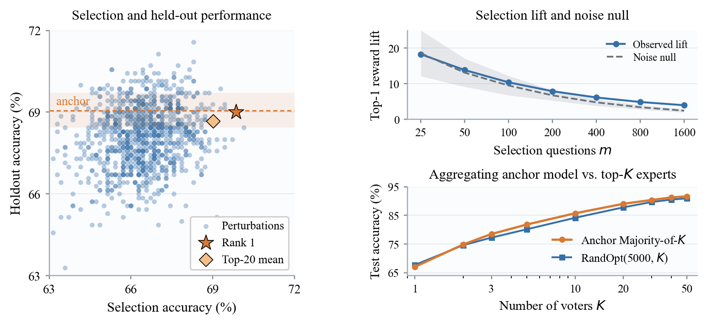

<div align="center">
  <h1>
    Does Random Search Discover Task Experts?<br>
    Revisiting Neural Thickets
  </h1>

  <hr style="width: 60%; border: none; border-top: 2px solid #ccc; margin: 0 auto 20px auto;">

  <a href="https://github.com/asil012/RevisitingNeuralThickets">
    
  </a>
</div>

<div align="center">

[](https://github.com/asil012/RevisitingNeuralThickets)
[](#quick-start)
[](data/)
[](LICENSE)

</div>

We study a curious question:

> *Can pre-trained models be adapted to tasks through mere random search in weight space, rather than explicit post-training?*

Surprisingly, such an approach was proposed in [*Neural Thickets: Diverse Task Experts Are Dense Around Pretrained Weights*](https://arxiv.org/abs/2603.12228) (ICML 2026 Spotlight). In particular, the Neural Thickets paper claims that pretrained models
lie in a region of weight space densely populated by task experts. In fact, this effect is so pronounced that simply applying
Gaussian weight perturbations to a pretrained model has considerable probability (e.g., >10%) of producing a strictly more performant
model for a particular task (e.g., in reasoning, programming, chemistry). 

Our experiments closely revisit these claims, and question whether random weight perturbations indeed produce task experts. We build upon
the released [RandOpt repository](https://github.com/sunrainyg/RandOpt) from the original Neural Thickets paper, at commit
[`536df`](https://github.com/sunrainyg/RandOpt/commit/536df0a308f3990b6270c991fbb96bd0b779a58e).

## Quick Start

All six figures and fifteen tables reported in the paper can be regenerated from
[artifacts](data/) included in this repository:

```bash
python3.11 -m venv .venv
source .venv/bin/activate
python -m pip install -e ".[test]"

python scripts/reproduce_paper.py --output-dir reproduced
```

To regenerate only the figures or tables, use `scripts/reproduce_figures.py` or
`scripts/reproduce_tables.py`, respectively.

### Experiment Setup

The code for running all experiments is included in
[`src/neural_thickets/experiments/`](src/neural_thickets/experiments/). Each
experiment also has a corresponding entry in
[`configs/experiments.yaml`](configs/experiments.yaml), specifying the model
revision, perturbation rule, decoding parameters, and runtime.

```bash
python -m pip install -e ".[experiments]"

neural-thickets-run \
  --contract density_greedy_anchor_qwen05b_suite \
  --phase plan \
  --output-dir runs/density_greedy_anchor_qwen05b
```

## Repository Layout

```text
configs/       Experiment settings
data/          Data used to reproduce the figures and tables
scripts/       Figure, table, and experiment scripts
src/           Perturbation, scoring, and analysis code
tests/         Tests
```

## Perturbation Implementations

RandOpt resets its random-number generator before perturbing each parameter
tensor. As a result, tensors with the same shape receive the same noise pattern.
We preserve this behavior in `paper_tied_exact`; our corrected `iid_exact`
implementation advances one generator through the model, giving each tensor a
separate Gaussian draw.

Both main implementations reload the saved anchor weights after evaluating each
candidate. This avoids the small numerical drift that can accumulate when a
bfloat16 perturbation is repeatedly added and subtracted. We also retain the
original subtractive restoration path used for the implementation audit in the
paper.

## Acknowledgments

We thank Yulu Gan and Phillip Isola for releasing
[`sunrainyg/RandOpt`](https://github.com/sunrainyg/RandOpt). Apache-licensed
components preserve their source headers, and their license is included in
[`LICENSE-APACHE`](LICENSE-APACHE). We also thank the authors and maintainers of
the models and datasets used in this audit, including OLMo, Qwen2.5, Countdown,
GSM8K, MBPP, and USPTO-50K.

## Citation

```bibtex
@misc{asilis2026revisitingneural,
  title  = {Does Random Search Discover Task Experts? Revisiting Neural Thickets},
  author = {Julian Asilis and Guanzhe Hong and Vatsal Sharan},
  year   = {2026},
  note   = {Preprint}
}
```

